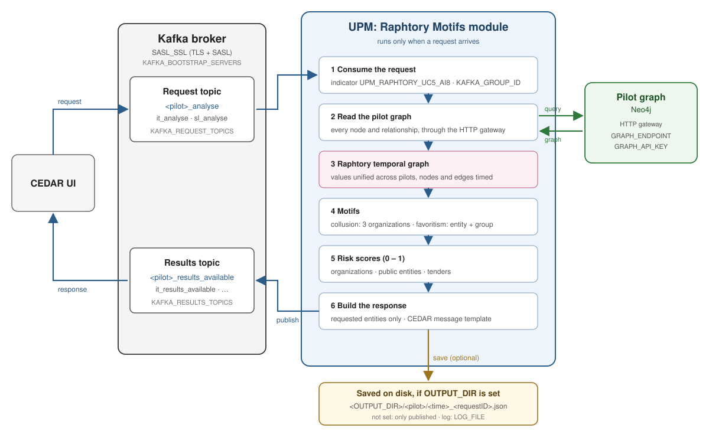
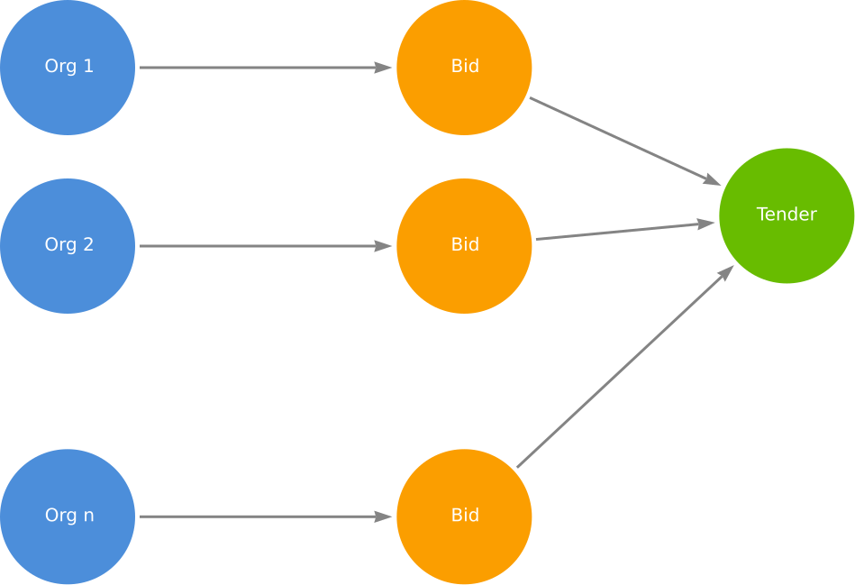
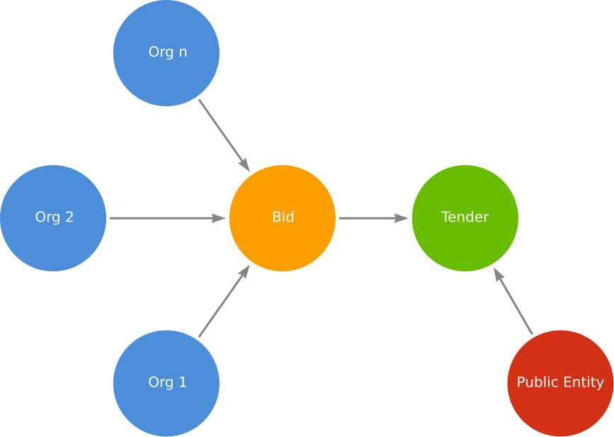

# CEDAR Risk Scoring

A risk-assessment module that assigns an anomaly score (0 – 1) to every
**organization**, **public entity** and **tender** of a CEDAR pilot's
public-procurement graph. It targets two procurement-fraud scenarios:

- **Collusion** — a group of organizations that repeatedly bid together and share
  contracts through coordinated behaviour.
- **Favoritism** — a contracting authority that repeatedly awards its tenders to
  the same group of organizations.

The module is a Kafka service: it listens for analysis requests, scores the
requested pilot's graph, and answers with one response that follows the CEDAR
Kafka message contract.

## How it works

<p align="center">
  
</p>

1. **Consume the request.** The UI publishes a request on the pilot's request
   topic (e.g. `it_analyse`). The module keeps only the requests that ask for its
   indicator, `UPM_RAPHTORY_UC5_AI8`; the topics are shared with other tools.
2. **Read the pilot graph.** Every node and relationship of the pilot's
   knowledge graph is read from Neo4j, through the pilot's HTTP gateway.
3. **Build a Raphtory temporal graph.** The values the pilots store differently
   (booleans, prices, dates) are unified, and every node and edge gets a time.
4. **Extract motifs**, the recurring patterns of each scenario:
   - **Collusion:** groups of 3 organizations that repeatedly bid on the same tenders.
   - **Favoritism:** a public entity repeatedly awarding its tenders to the same group.
5. **Score** every organization, public entity and tender.
6. **Build the response** with the requested entities only, **save it to disk**
   if `OUTPUT_DIR` is set, then **publish** it on the pilot's results topic
   (e.g. `it_results_available`).

Nothing runs between requests: each request is scored on the graph as it is at
that moment.

<table align="center">
  <tr>
    <td align="center" style="padding-right: 50px;">
      <br>
      <b>Collusion</b>
    </td>
    <td align="center" style="padding-left: 50px;">
      <br>
      <b>Favoritism</b>
    </td>
  </tr>
</table>

### What drives each score

| Node | Scenario | Signals |
|------|----------|---------|
| Organization | Collusion | recurrence of the same bidding group, joint success rate, inflated cover bids, winner rotation, consistent responsible person |
| Public entity | Favoritism | a group repeatedly winning the entity's tenders, high success rate, the group targeting this entity, the same person awards to the same group, restricted competition |
| Tender | Inherited | collusion risk of its winning organization and favoritism risk of its issuing entity (for open tenders, the estimated likelihood a suspicious group wins) |

---

# Configuration

Everything is configured in one `.env` file at the root of the project.
[`.env.example`](.env.example) is a complete template with the production values:

```bash
cp .env.example .env      # then fill in the empty fields
```

## 1. Pilots and their graphs

`PILOTS` lists the pilots this module serves. Each pilot's graph is read through
its HTTP gateway, which needs an API key.

| Variable | Meaning |
|---|---|
| `PILOTS` | pilots to serve, comma or space separated |
| `GRAPH_ENDPOINT` | gateway URL; `{pilot}` is replaced by the pilot's name |
| `GRAPH_API_KEY` | the gateway's API key (sent as `X-API-Key`) |
| `GRAPH_ENDPOINT_<PILOT>`, `GRAPH_API_KEY_<PILOT>` | optional, for one pilot only; they take precedence |

```dotenv
PILOTS=it,sl
GRAPH_ENDPOINT=https://kg-{pilot}.cedar-heu-project.eu/neo4j/query
GRAPH_API_KEY=<the gateway key>

```

A pilot with no API key is skipped at start-up, with a warning in the log.
`python main.py --pilots it` serves only the pilots given on the command line,
whatever `PILOTS` says.

## 2. Kafka connection

The CEDAR cluster uses **SASL_SSL**: TLS with a client certificate signed by the
cluster CA, plus a SASL `PLAIN` username and password. The variables are the ones
of the coordinators' template ([`secure-kafka/README.md`](secure-kafka/README.md));
the credentials come from your partner archive (`secure-kafka/users/upm.7z`),
which extracts to a `upm/` folder holding the three files and `cred.txt`.

| Variable | Meaning |
|---|---|
| `KAFKA_BOOTSTRAP_SERVERS` | the broker, `host:port` |
| `KAFKA_CREDENTIALS_DIR` | the extracted `upm/` folder (`kafka-cedar-ca-1.crt`, `upm.certificate.pem`, `upm.key`) |
| `KAFKA_KEY_PASSWORD` | line 1 of `cred.txt`: the private key passphrase |
| `KAFKA_SASL_USERNAME` | line 2 of `cred.txt` |
| `KAFKA_SASL_PASSWORD` | line 3 of `cred.txt` |

```dotenv
KAFKA_BOOTSTRAP_SERVERS=kafka.cedar-heu-project.eu:8004
KAFKA_CREDENTIALS_DIR=/secure/place/upm          # outside the repository
KAFKA_KEY_PASSWORD=<cred.txt line 1>
KAFKA_SASL_USERNAME=<cred.txt line 2>
KAFKA_SASL_PASSWORD=<cred.txt line 3>
```

> [!NOTE]
> So with `KAFKA_CREDENTIALS_DIR=/secure/place/upm` and `KAFKA_SASL_USERNAME=upm`, it looks for:
>
> - `/secure/place/upm/kafka-cedar-ca-1.crt`
> - `/secure/place/upm/upm.certificate.pem`
> - `/secure/place/upm/upm.key`

The three files are found in `KAFKA_CREDENTIALS_DIR` under their archive names.
Only if one was renamed or kept elsewhere, point to it directly; each variable
replaces just that one file. Docker ignores them (the container only sees the
mounted folder), so with Docker keep the files in the folder under their names:

| Variable | Default (leave empty to use it) |
|---|---|
| `KAFKA_CA_FILE` | `<KAFKA_CREDENTIALS_DIR>/kafka-cedar-ca-1.crt` |
| `KAFKA_CERT_FILE` | `<KAFKA_CREDENTIALS_DIR>/<KAFKA_SASL_USERNAME>.certificate.pem` |
| `KAFKA_KEY_FILE` | `<KAFKA_CREDENTIALS_DIR>/<KAFKA_SASL_USERNAME>.key` |

## 3. Request and results topics

Each pilot has a **request topic**, where the UI publishes the requests, and a
**results topic**, where the module publishes its responses.

| Variable | Meaning |
|---|---|
| `KAFKA_REQUEST_TOPICS` | the request topics; each one is matched to its pilot by its `<pilot>_` prefix |
| `KAFKA_RESULTS_TOPICS` | the results topics, matched the same way |
| `KAFKA_REQUEST_TOPIC_<PILOT>`, `KAFKA_RESULTS_TOPIC_<PILOT>` | **Optional**, for a topic whose name does not start with `<pilot>_` |
| `INDICATOR_ID` | this module's indicator: a request is answered only if it lists it (default `UPM_RAPHTORY_UC5_AI8`) |

```dotenv
KAFKA_REQUEST_TOPICS=it_analyse,sl_analyse
KAFKA_RESULTS_TOPICS=it_results_available,sl_results_available
INDICATOR_ID=UPM_RAPHTORY_UC5_AI8

# (Optional) a topic with another naming:
KAFKA_REQUEST_TOPIC_IT=cedar.it.requests
```

Without any of them, the contract's names are used: `<pilot>_analyse` and
`<pilot>_results_available`. The topics actually used are logged at start-up:

```text
[pilots]  it: it_analyse -> it_results_available
[pilots]  sl: sl_analyse -> sl_results_available
```

> [!IMPORTANT]
> **A request** is answered only if its `indicators` list contains the module's
> indicator, `INDICATOR_ID` (default `UPM_RAPHTORY_UC5_AI8`). It scores tenders, organizations and public entities
> (`entityType`: `tender`, `organization`, `publicEntity`).
> `entityId` may be `"all"` (every entity of that type), and
> `{"entityType": "all", "entityId": "all"}` asks for the whole graph:

```json
{
  "issuer": "ui",
  "requestID": "5f1c2e0a-7b8e-4a43-9a51-0b6d3c2f9e11",
  "indicators": ["UPM_RAPHTORY_UC5_AI8"],
  "entities": [{"entityType": "tender", "entityId": "EN_N_101_2025"},
               {"entityType": "organization", "entityId": "all"}],
  "kg": {"versionId": "latest"},
  "accounting": {}, "status": {}
}
```

**The response** carries one indicator per requested entity, with its
`risk_level` and the details behind it:

```json
{
  "requestID": "5f1c2e0a-7b8e-4a43-9a51-0b6d3c2f9e11",
  "responseID": "bcec5730-f420-4fad-adf1-fcb939fef871",
  "toolName": "UPM_RAPHTORY_MOTIFS",
  "analysis": {
    "startTime": 1760536800000, "endTime": 1760536801400,
    "indicators": [{
      "id": "0fba0570-…",
      "indicator_id": "UPM_RAPHTORY_UC5_AI8",
      "entityID": "EN_N_101_2025",
      "risk_level": 0.012,
      "additional_info": [
        {"id": "7ba9a46e-…", "title": "Collusion risk", "type": "numeric", "value": 0.008,
         "risk_level": 0.008, "range": {"from": 0.0, "to": 1.0},
         "description": "Awarded: risk of the winning organization. …"},
        {"id": "d1c485ff-…", "title": "Bidding stage", "type": "text", "value": "awarded"}
      ]
    }]
  },
  "source": {"kg": {"versionId": "latest",
                    "entities": [{"entityType": "tender", "entityId": "EN_N_101_2025"}]}}
}
```


## 4. Consumer group

The module reads the request topics as the Kafka consumer group `KAFKA_GROUP_ID`.
Kafka remembers, per group, which requests were already handled: after a restart
the module answers the requests that arrived while it was down, and never answers
one twice. Keep one fixed name:

```dotenv
KAFKA_GROUP_ID=upm-raphtory
```

## 5. Logger

The log goes to the console and to a file that rotates at midnight:

| Variable | Meaning | Default |
|---|---|---|
| `LOG_LEVEL` | `DEBUG`, `INFO`, `WARNING` or `ERROR` | `INFO` |
| `LOG_FILE` | the log file; `none` = console only | `logs/cedar.log` |
| `LOG_BACKUPS` | days of old log files to keep | unset: every day is kept |

```dotenv
LOG_LEVEL=INFO
LOG_FILE=logs/cedar.log      # rotated into logs/cedar.log.2026-10-15, ...
LOG_BACKUPS=30
```

Every step is logged, and each error with its message and traceback:

```text
2026-10-15 11:40:01 [INFO] upm_raphtory.main: [request] sl 4daba915-… from 'ui': 1 Tender
2026-10-15 11:40:03 [INFO] upm_raphtory.main: [scores]  57 organizations, 1 entities, 36 tenders
2026-10-15 11:40:03 [INFO] upm_raphtory.main: [kafka]   response ae1c6766-… (1 indicators) -> sl_results_available
```

## 6. Saving the responses on disk (optional)

`OUTPUT_DIR` is the folder where each response is saved as JSON, **before** it is
published, so it is kept even if Kafka is unreachable or refuses it. When
`OUTPUT_DIR` is not set (or empty), responses are **not saved**: they are only
published to the Kafka broker.

| Variable | Meaning | Default |
|---|---|---|
| `OUTPUT_DIR` | folder for the saved responses; start the path with `./` or `/` | unset: not saved |

```dotenv
OUTPUT_DIR=./outputs
```

```text
outputs/sl_latest.json                              the last response of the pilot
outputs/sl/20261015T094003Z_4daba915-….json          one file per response
```
---

# Running the module

Once `.env` is configured for the CEDAR cluster, one command builds and starts
the module:

```bash
make run         # build and start the module
make stop        # stop it
make restart     # after a change in the code or in .env
```

`make run` prints the broker it uses (`KAFKA_BOOTSTRAP_SERVERS`). The log:
`docker logs -f cedar-risk`, or `logs/cedar.log`.

The container reads `.env`, uses the host's network, mounts
`KAFKA_CREDENTIALS_DIR` read-only, and keeps `OUTPUT_DIR` (if set) and `logs/` on
the host. It restarts by itself after a crash or a reboot.

---

# Contact

For any issue with this module, contact:

| Name | Email |
|---|---|
| Félix Cuadrado | [felix.cuadrado@upm.es](mailto:felix.cuadrado@upm.es) |
| José Miguel Blanco | [josemiguel.blanco@upm.es](mailto:josemiguel.blanco@upm.es) |
| Wassim Sliti | [wassim.sliti@upm.es](mailto:wassim.sliti@upm.es) |

