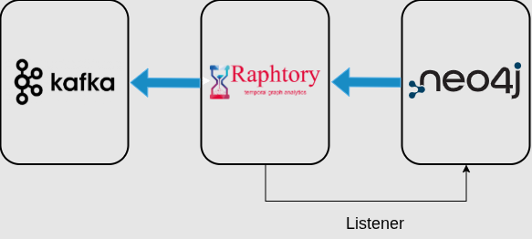

# CEDAR Risk Scoring

A risk-assessment module that assigns an anomaly score to every **organization**,
**public entity**, and **tender** in a public-procurement graph. It targets two
procurement-fraud scenarios:

- **Collusion** — a group of organizations that repeatedly bid together and share
  contracts through coordinated behaviour.
- **Favoritism** — a contracting authority that repeatedly awards its tenders to
  the same group of organizations.

The module is built on a **Raphtory** temporal graph and publishes its results to
a **Kafka** topic following the VICOM message template.

## Pipeline

<p align="center">
  <a href="images/cedar_white_bg.png" target="_blank">
    
  </a>
</p>

1. **Retrieve** the procurement data from the Neo4j graph and rebuild it as a
   Raphtory temporal graph.

2. **Extract motifs** — detect the recurring structural patterns in the Raphtory
   graph that flag each scenario:
   - **Motif 1 — collusion:** groups of organizations that repeatedly bid together
     on the same tenders.
   - **Motif 2 — favoritism:** public entities that repeatedly award their tenders
     to the same group of organizations.

3. **Score** every organization, public entity, and tender for collusion and
   favoritism, based on the extracted motifs.

4. **Publish** the scores to the Kafka broker.

<table align="center">
  <tr>
    <td align="center" style="padding-right: 50px;">
      <br>
      <span style="font-size: 24px; font-weight: bold;">Collusion</span>
    </td>
    <td align="center" style="padding-left: 50px;">
      <br>
      <span style="font-size: 24px; font-weight: bold;">Favoritism</span>
    </td>
  </tr>
</table


A **listener** continuously watches the Neo4j graph for structural changes and
recomputes the scores whenever new procurement activity is added, so the risk
assessment always reflects the current state of the graph.

> **Note.** For testing, the module generates a **synthetic** procurement dataset
> that mixes normal activity with planted abnormal scenarios (collusion rings and
> graded favoritism cases), allowing the scoring to be validated end-to-end before
> it is pointed at real pilot data.


### What drives each score

| Node | Scenario | Signals |
|------|----------|---------|
| Organization | Collusion | recurrence of the same bidding group, joint success rate, inflated cover bids, winner rotation, consistent responsible person |
| Public entity | Favoritism | a group repeatedly winning the entity's tenders, high success rate, the group targeting this entity, the same person awards to the same group, restricted competition |
| Tender | Inherited | collusion risk of its winning organization and favoritism risk of its issuing entity (for open tenders, the estimated likelihood a suspicious group wins) |


---

# Running the module

## 1. Launch (Neo4j, HTTP endpoint, Kafka)

In the CEDAR project the partners store each pilot's procurement data in a Neo4j
graph, and — following the VICOM integration — the risk score of each entity is
computed and published to a Kafka topic. To reproduce that setup locally, the
`docker-compose.yml` starts:

- **Neo4j** — holds the (generated) procurement graph the module reads from;
- an **HTTP endpoint** — exposes the Neo4j graph to the module over HTTP;
- a **Kafka broker** — receives the scores the module publishes.

```bash
docker compose up -d
```

## 2. Configure the environment

Create an `.env` file with the connection settings. For a real deployment, replace
these with the actual graph endpoint and API key and the deployed Kafka endpoint
and credentials — the module then runs against real procurement data unchanged.

```dotenv
# Neo4j HTTP gateway
GRAPH_ENDPOINT=http://localhost:8000/neo4j/query
GRAPH_API_KEY=cedar_local_0bc4c44d8c89412fbc4f6271eb28c3f4952f0e89f06c487bb6fb61d6e4fd95af

# Kafka
KAFKA_BOOTSTRAP=localhost:9092
KAFKA_USERNAME=cip
KAFKA_PASSWORD=carletto
KAFKA_SECURITY_PROTOCOL=SASL_PLAINTEXT
KAFKA_SASL_MECHANISM=PLAIN
KAFKA_TOPIC=VICOM_CORRELAX
```

## 3. Build and run the risk-assessment module

Build the image:

```bash
docker build -t cedar-analysis .
```

Run the module:

```bash
docker run --name raphtory-risk-module \
       --rm --env-file .env \
       --network host cedar-analysis
```

On startup the module generates and loads the synthetic graph into Neo4j, computes
the organization / public-entity / tender scores, publishes them to Kafka, and then
keeps running to re-score the graph whenever it changes. 

## 4. Inspect the published scores

In a separate terminal, consume the `VICOM_CORRELAX` topic to see the messages the
module published:

```bash
docker exec -it kafka-local /opt/kafka/bin/kafka-console-consumer.sh \
  --bootstrap-server localhost:9092 \
  --consumer.config /etc/kafka/secrets/client-sasl.properties \
  --topic VICOM_CORRELAX --from-beginning
```

The `client-sasl.properties` referenced above provides the consumer's SASL
credentials:

```properties
security.protocol=SASL_PLAINTEXT
sasl.mechanism=PLAIN
sasl.jaas.config=org.apache.kafka.common.security.plain.PlainLoginModule required username="cip" password="carletto";
```